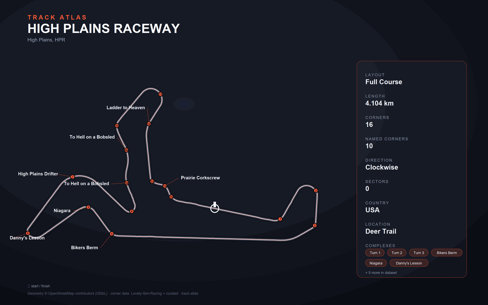

# High Plains Raceway — Full Course

Provisional full-course geometry for the clockwise, 2.55-mile configuration.

Sources:

- [Official configurations](https://www.highplainsraceway.com/track-info/)
- [Official full-course diagram](https://www.highplainsraceway.com/wp-content/uploads/Full-Course.jpg)
- OpenStreetMap ways downloaded through Overpass (ODbL; raw response retained).

`track.py` selects the full-course ways explicitly. The main straight is
named **Short North**, and **High Plains Drifter** contains a word fragment
normally excluded by the generic stitcher. Shared internal OSM nodes must
also be split at junctions to preserve the full Prairie Corkscrew section.
The generated OSM loop is approximately 4,100 m, compared with 4,104 m nominal.

Turn labels follow the official diagram, including 9a/9b. Their provisional
markers describe geometric apexes, not measured vehicle braking points.
**Start/finish is approximate, based on the official diagram, and must be
confirmed before relying on it for lap timing.** Pit markers and timing
sectors have not been invented.

The measured surface is in `raw/surface-full.json`, generated from USDA NAIP
imagery registered against `CO_Eastern_B3_2018` USGS 3DEP lidar. Both edges
were observed on 96.4% of the lap (left 99.3%, right 97.1%); median width is
10.71 m. The reported position budget is 1.236 m CE95, including an **assumed**
1.0 m lidar reference accuracy, not a surveyed guarantee. The imagery edge
overlays were visually reviewed at all 16 numbered corner points.

Regeneration replaces the OSM seed with the measured midline. The displayed
loop is approximately 4,103 m; the raw surface measurement records 4,107.2 m
before downstream geometry processing. Start/finish remains approximate.
Validation passes with warnings for unknown series/pit/timing-sector metadata,
the assumed lidar accuracy, and a measured corner-complex grouping warning
for the two bends of Turn 9.

Private telemetry recordings remain outside the public dataset and are not
inputs to the surface measurement.

Generate and validate on Windows using the local environment:

```powershell
.\.venv\Scripts\python.exe -X utf8 scripts/generate.py high-plains-raceway
.\.venv\Scripts\python.exe -X utf8 scripts/render.py high-plains-raceway
.\.venv\Scripts\python.exe -X utf8 scripts/verify.py high-plains-raceway
```


